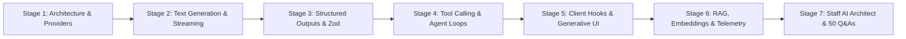
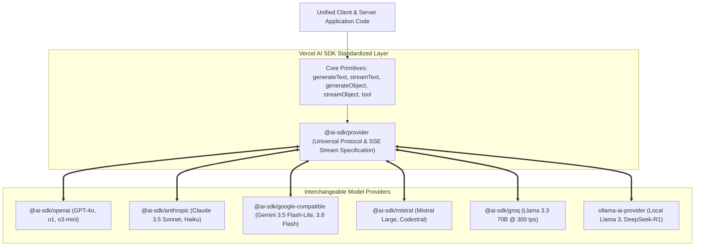
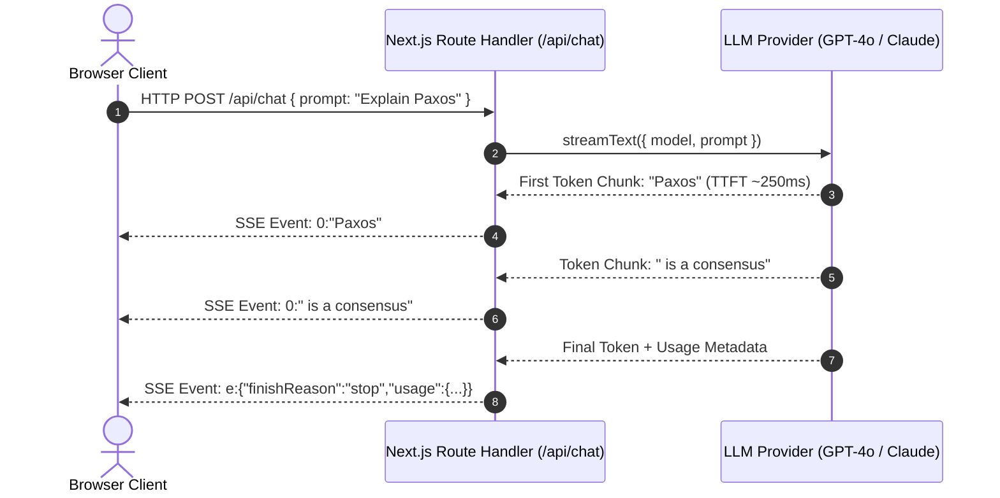
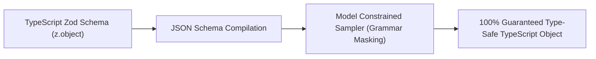
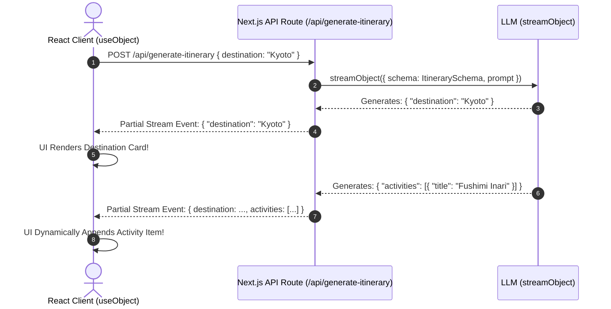
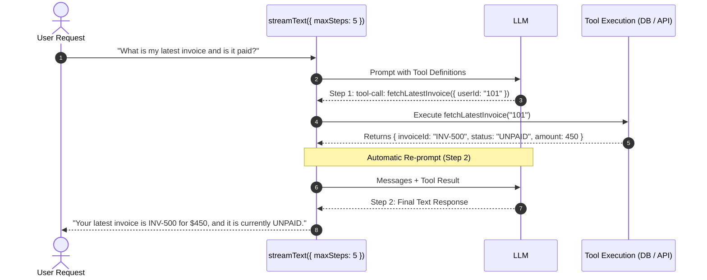
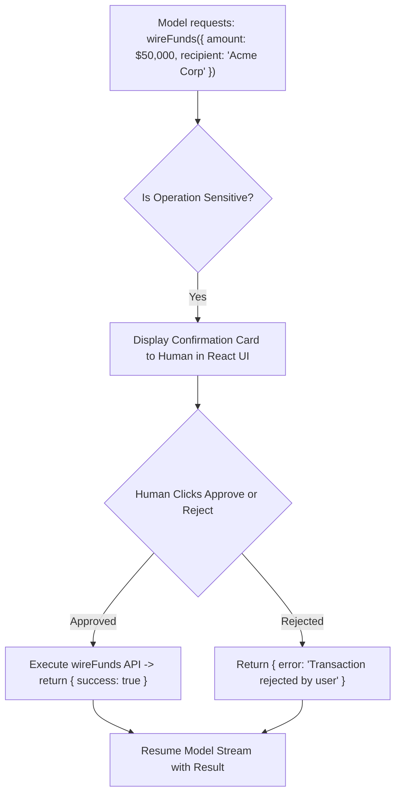
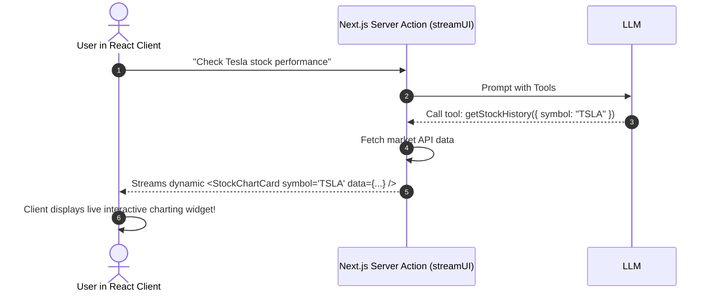
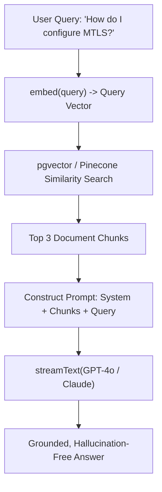
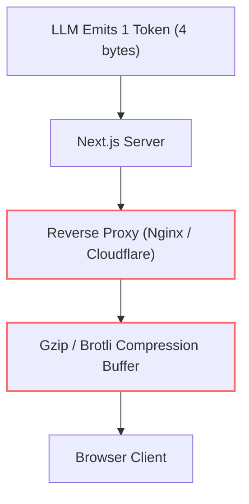

# Vercel AI SDK Masterclass: Enterprise Generative AI Engineering

[](https://sdk.vercel.ai/)
[](https://www.typescriptlang.org/)
[](https://sdk.vercel.ai/providers)
[](LICENSE)
[](https://vercel.com/)

Welcome to the **Staff-Level Masterclass on the Vercel AI SDK**. This curriculum delivers an exhaustive, production-grade guide to building next-generation Generative AI applications, autonomous agents, and streaming user interfaces using TypeScript and modern web runtimes. From unified provider abstractions and low-latency SSE streaming to deterministic Zod-governed structured outputs, multi-step tool execution loops, Generative UI with React Server Components, and enterprise RAG telemetry, this guide provides complete engineering architectures.

---

## Pedagogical Roadmap: 7-Stage Curriculum



---

## Master Table of Contents

- [Stage 1: Absolute Beginner Foundations & Unified AI Architecture](#stage-1-absolute-beginner-foundations--unified-ai-architecture)
  - [1.1 The Fragmented LLM Landscape vs The Unified AI SDK Abstraction](#11-the-fragmented-llm-landscape-vs-the-unified-ai-sdk-abstraction)
  - [1.2 Ecosystem Architecture: `ai` Core vs `@ai-sdk/provider` vs `@ai-sdk/react`](#12-ecosystem-architecture-ai-core-vs-ai-sdkprovider-vs-ai-sdkreact)
  - [1.3 Multi-Provider Support: OpenAI, Anthropic, Google Gemini, Mistral, Groq, Ollama](#13-multi-provider-support-openai-anthropic-google-gemini-mistral-groq-ollama)
  - [1.4 Dynamic Model Routing with `createProviderRegistry`](#14-dynamic-model-routing-with-createproviderregistry)
  - [1.5 Installation & Project Scaffolding](#15-installation--project-scaffolding)
  - [1.6 Runtime Environments: Edge Runtime vs Node.js vs Cloudflare Workers](#16-runtime-environments-edge-runtime-vs-nodejs-vs-cloudflare-workers)
- [Stage 2: Core Text Generation & Streaming Engine](#stage-2-core-text-generation--streaming-engine)
  - [2.1 Synchronous / Non-Streaming Generation (`generateText`)](#21-synchronous--non-streaming-generation-generatetext)
  - [2.2 Low-Latency Token Streaming (`streamText`)](#22-low-latency-token-streaming-streamtext)
  - [2.3 Stream Transformations: Server-Sent Events (SSE) & `toDataStreamResponse`](#23-stream-transformations-server-sent-events-sse--todatastreamresponse)
  - [2.4 Stream Lifecycles & Telemetry (`onChunk`, `onFinish`)](#24-stream-lifecycles--telemetry-onchunk-onfinish)
  - [2.5 Stream Cancellation Mechanics with `AbortController`](#25-stream-cancellation-mechanics-with-abortcontroller)
- [Stage 3: Structured Outputs & Object Generation](#stage-3-structured-outputs--object-generation)
  - [3.1 The Deterministic Output Problem (Prompting vs Native JSON Schema)](#31-the-deterministic-output-problem-prompting-vs-native-json-schema)
  - [3.2 Deterministic Object Generation with Zod (`generateObject`)](#32-deterministic-object-generation-with-zod-generateobject)
  - [3.3 Generation Modes: `auto` vs `json` vs `tool`](#33-generation-modes-auto-vs-json-vs-tool)
  - [3.4 Partial Object Streaming to React Clients (`streamObject`)](#34-partial-object-streaming-to-react-clients-streamobject)
  - [3.5 Schema Validation Repair & Fallback Engineering](#35-schema-validation-repair--fallback-engineering)
- [Stage 4: Tool Calling & Autonomous Agent Loops](#stage-4-tool-calling--autonomous-agent-loops)
  - [4.1 The `tool()` Primitive & Zod Parameter Contracts](#41-the-tool-primitive--zod-parameter-contracts)
  - [4.2 Autonomous Multi-Step Re-Prompt Loops with `maxSteps`](#42-autonomous-multi-step-re-prompt-loops-with-maxsteps)
  - [4.3 Client-Side vs Server-Side Tool Execution](#43-client-side-vs-server-side-tool-execution)
  - [4.4 Human-in-the-Loop (HITL) Confirmation Checkpoints](#44-human-in-the-loop-hitl-confirmation-checkpoints)
  - [4.5 Multi-Tool Orchestration & Parameter Error Recovery](#45-multi-tool-orchestration--parameter-error-recovery)
- [Stage 5: Client-Side Hooks & UI Engineering](#stage-5-client-side-hooks--ui-engineering)
  - [5.1 Multi-Turn Conversational Hook (`useChat`)](#51-multi-turn-conversational-hook-usechat)
  - [5.2 Autocompletion & Document Editing (`useCompletion`)](#52-autocompletion--document-editing-usecompletion)
  - [5.3 Generative UI: Streaming React Server Components with `streamUI`](#53-generative-ui-streaming-react-server-components-with-streamui)
  - [5.4 Enterprise Chat Persistence: PostgreSQL / Supabase Message Hydration](#54-enterprise-chat-persistence-postgresql--supabase-message-hydration)
  - [5.5 Optimistic Updates & Custom Network Headers](#55-optimistic-updates--custom-network-headers)
- [Stage 6: Enterprise RAG, Embeddings, Middleware & Observability](#stage-6-enterprise-rag-embeddings-middleware--observability)
  - [6.1 Vector Embeddings with `embed` and `embedMany`](#61-vector-embeddings-with-embed-and-embedmany)
  - [6.2 In-Memory & Vector Database Semantic Search](#62-in-memory--vector-database-semantic-search)
  - [6.3 Custom AI SDK Middleware: Caching, Guardrails & Token Limiting](#63-custom-ai-sdk-middleware-caching-guardrails--token-limiting)
  - [6.4 Observability & OpenTelemetry Tracing (Langfuse & Helicone)](#64-observability--opentelemetry-tracing-langfuse--helicone)
- [Stage 7: Staff AI Architect: Enterprise Blueprint, Production Edge Cases & 50 Interview Q&As](#stage-7-staff-ai-architect-enterprise-blueprint-production-edge-cases--50-interview-qas)
  - [7.1 Production Enterprise Blueprint: Autonomous Support & Analyst Agent](#71-production-enterprise-blueprint-autonomous-support--analyst-agent)
  - [7.2 Edge Runtime Pitfalls & Streaming Buffer Optimization](#72-edge-runtime-pitfalls--streaming-buffer-optimization)
  - [7.3 50 Staff-Level AI Engineering & Vercel AI SDK Interview Q&As](#73-50-staff-level-ai-engineering--vercel-ai-sdk-interview-qas)
  - [7.4 Master CLI, Configuration & API Cheat Sheet](#74-master-cli-configuration--api-cheat-sheet)

---

## Stage 1: Absolute Beginner Foundations & Unified AI Architecture

### 1.1 The Fragmented LLM Landscape vs The Unified AI SDK Abstraction

Prior to modern AI frameworks, integrating Large Language Models required wrestling with disparate vendor SDKs:
- **OpenAI SDK**: Uses `chat.completions.create()`, expects JSON schemas under `tools[].function.parameters`, and returns chunks via async generators.
- **Anthropic Claude SDK**: Uses `messages.create()`, handles system prompts as a separate top-level parameter, uses different streaming chunk structures, and formats tools differently.
- **Google Gemini APIs**: Native and OpenAI-compatible endpoints use different payload shapes and streaming event formats than OpenAI/Anthropic defaults.
- **Ollama / Local LLMs**: Requires custom HTTP endpoints, non-standard streaming delimiters, and manual prompt templates.

This fragmentation led to massive vendor lock-in. Switching models required rewriting API routes, parsers, and client UI consumers.

The **Vercel AI SDK** solves this by establishing a **standardized, vendor-agnostic specification**:



With the Vercel AI SDK, switching your entire enterprise infrastructure from **GPT-4o** to **Claude 3.5 Sonnet** or **Gemini 3.8 Flash** requires changing **exactly one line of code**:

```typescript
// From this:
const result = await streamText({ model: openai('gpt-4o'), prompt });

// To this:
const result = await streamText({ model: anthropic('claude-3-5-sonnet-20241022'), prompt });

// Or this:
const result = await streamText({ model: google('gemini-3.5-flash-lite'), prompt });
```

---

### 1.2 Ecosystem Architecture: `ai` Core vs `@ai-sdk/provider` vs `@ai-sdk/react`

The Vercel AI SDK is organized into modular packages to ensure minimal bundle sizes:

| Package | Role & Responsibility | Execution Environment |
| :--- | :--- | :--- |
| **`ai`** | Core engine: `generateText`, `streamText`, `generateObject`, `streamObject`, `embed`, `tool`. | Node.js, Edge, Serverless |
| **`@ai-sdk/provider`** | Low-level interfaces for building custom model providers and streaming adapters. | Universal |
| **`@ai-sdk/openai`** | Official OpenAI provider (models, embeddings, audio, moderation). | Server-side |
| **`@ai-sdk/anthropic`** | Official Anthropic Claude provider with prompt caching support. | Server-side |
| **`@ai-sdk/google-compatible`** | Google Gemini via OpenAI-compatible interface (pricing and availability vary by selected Gemini model and account tier). | Server-side |
| **`@ai-sdk/react`** | Client UI hooks: `useChat`, `useCompletion`, `useObject`. | React / Next.js Client |
| **`@ai-sdk/vue`** | Vue 3 composition API hooks for chat and completion streaming. | Vue Client |
| **`@ai-sdk/svelte`** | Svelte 5 runes and stores for streaming UI. | Svelte Client |

---

### 1.3 Multi-Provider Support: OpenAI, Anthropic, Google Gemini, Mistral, Groq, Ollama

Install the core package alongside the providers you plan to utilize:

```bash
# Core package + UI bindings
npm install ai @ai-sdk/react zod

# Model providers
npm install @ai-sdk/openai @ai-sdk/anthropic @ai-sdk/google-compatible @ai-sdk/mistral @ai-sdk/groq
```

#### Configuring Environment Variables (`.env.local`)

```env
OPENAI_API_KEY="sk-proj-..."
ANTHROPIC_API_KEY="sk-ant-..."
GOOGLE_GENERATIVE_AI_API_KEY="AIzaSy..."
MISTRAL_API_KEY="..."
GROQ_API_KEY="gsk_..."
```

---

### 1.4 Dynamic Model Routing with `createProviderRegistry`

In enterprise SaaS systems, you often want to dynamically route requests based on user tier, cost constraints, or latency requirements (e.g. use **Groq Llama 3** for low-latency triage, and fallback to **GPT-4o** or **Claude 3.5 Sonnet** for complex code reasoning).

The AI SDK includes `createProviderRegistry()` for dynamic multi-provider routing:

```typescript
import { createProviderRegistry } from 'ai';
import { openai } from '@ai-sdk/openai';
import { anthropic } from '@ai-sdk/anthropic';
import { google } from '@ai-sdk/google-compatible';

// 1. Create a centralized provider registry
export const registry = createProviderRegistry({
  openai,
  anthropic,
  google,
});

// 2. Select model dynamically via string identifiers (e.g. 'openai:gpt-4o', 'anthropic:claude-3-5-sonnet-20241022')
export function getModelForTask(tier: 'fast' | 'reasoning' | 'creative') {
  switch (tier) {
    case 'fast':
      return registry.languageModel('openai:gpt-4o-mini');
    case 'reasoning':
      return registry.languageModel('anthropic:claude-3-5-sonnet-20241022');
    case 'creative':
      return registry.languageModel('google:gemini-3.8-flash');
  }
}
```

---

### 1.5 Installation & Project Scaffolding

An enterprise Next.js 15 App Router directory layout for AI SDK:

```text
my-ai-platform/
├── src/
│   ├── app/
│   │   ├── api/
│   │   │   ├── chat/
│   │   │   │   └── route.ts         # Multi-turn streaming chat endpoint
│   │   │   ├── extract/
│   │   │   │   └── route.ts         # Structured JSON extraction endpoint
│   │   │   └── agent/
│   │   │       └── route.ts         # Autonomous multi-step tool agent
│   │   ├── chat/
│   │   │   └── page.tsx             # React UI using useChat
│   │   └── layout.tsx
│   ├── lib/
│   │   ├── ai/
│   │   │   ├── models.ts            # Provider registry and routing
│   │   │   ├── tools/
│   │   │   │   ├── weather.tool.ts  # Type-safe Zod tools
│   │   │   │   └── database.tool.ts
│   │   │   └── middleware.ts        # Telemetry & rate-limiting middleware
│   └── types/
│       └── schemas.ts               # Shared Zod domain schemas
├── .env.local
├── package.json
└── tsconfig.json
```

---

### 1.6 Runtime Environments: Edge Runtime vs Node.js vs Cloudflare Workers

The Vercel AI SDK is built on native Web Standards (`fetch`, `ReadableStream`, `TransformStream`, `Headers`). It runs seamlessly across:

1. **Node.js Runtime** (Default): Full access to native Node.js filesystem, TCP sockets, database connection pools (`pg`, `mysql2`), and heavyweight libraries. Maximum execution timeout: 60s–300s (depending on cloud host).
2. **Vercel Edge Runtime**: Boots in 0ms globally at edge points of presence. Fast TTFT (Time To First Token). Limitations: No native C++ addons, 1MB–4MB bundle size limits.
3. **Cloudflare Workers**: Full compatibility using Web Standards.

```typescript
// Explicitly declare runtime in Next.js App Router route handlers:
export const runtime = 'edge'; // or 'nodejs'
export const maxDuration = 60; // 60 seconds execution limit
```

---

## Stage 2: Core Text Generation & Streaming Engine

### 2.1 Synchronous / Non-Streaming Generation (`generateText`)

When you need an immediate string output—such as in background cron jobs, batch data transformations, classification pipelines, or CLI scripts—`generateText` executes the model request and awaits the complete result.

```typescript
import { generateText } from 'ai';
import { openai } from '@ai-sdk/openai';

async function summarizeArticle(articleText: string) {
  const { text, usage, finishReason, rawResponse } = await generateText({
    model: openai('gpt-4o'),
    system: 'You are an executive summary assistant. Be concise, direct, and factual.',
    prompt: `Summarize the following document in 3 bullet points:\n\n${articleText}`,
    temperature: 0.3, // Low temperature for deterministic factual extraction
    maxTokens: 500,
    topP: 0.9,
    headers: {
      'x-custom-request-id': 'req-98214',
    },
  });

  console.log(`Generated summary:\n${text}`);
  console.log(`Prompt Tokens: ${usage.promptTokens}`);
  console.log(`Completion Tokens: ${usage.completionTokens}`);
  console.log(`Total Tokens: ${usage.totalTokens}`);
  console.log(`Termination Reason: ${finishReason}`); // 'stop' | 'length' | 'content-filter' | 'tool-calls'

  return text;
}
```

#### Multi-Turn Message History
Instead of a single string `prompt`, you can pass an array of conversational `messages`:

```typescript
const result = await generateText({
  model: openai('gpt-4o'),
  messages: [
    { role: 'system', content: 'You are an expert PostgreSQL DBA.' },
    { role: 'user', content: 'What is the purpose of pg_stat_statements?' },
    { role: 'assistant', content: 'pg_stat_statements is an extension that tracks execution statistics of all SQL statements...' },
    { role: 'user', content: 'How do I reset its metrics?' },
  ],
});
```

---

### 2.2 Low-Latency Token Streaming (`streamText`)

For user-facing interfaces, waiting 5 to 15 seconds for a complete LLM response causes severe user drop-off. Streaming emits tokens via Server-Sent Events (SSE) as they are generated by the model's neural network, delivering a **Time To First Token (TTFT)** under 300 milliseconds.



#### Server Route Handler Implementation (`src/app/api/chat/route.ts`)

```typescript
import { streamText } from 'ai';
import { openai } from '@ai-sdk/openai';

export const runtime = 'edge';

export async function POST(req: Request) {
  const { messages } = await req.json();

  const result = streamText({
    model: openai('gpt-4o'),
    system: 'You are a staff cloud architect helping engineers optimize AWS workloads.',
    messages,
    temperature: 0.7,
  });

  // Converts stream into standard Vercel AI Data Stream Protocol SSE response
  return result.toDataStreamResponse();
}
```

---

### 2.3 Stream Transformations: Server-Sent Events (SSE) & `toDataStreamResponse`

The Vercel AI SDK utilizes a high-efficiency streaming protocol where different chunk types are multiplexed over a single HTTP stream:

- `0:"text"`: Raw text delta.
- `b:"data"`: Custom backend data packet sent to client UI.
- `9:{"toolCallId":...}`: Tool invocation payload.
- `a:{"toolResult":...}`: Result of an executed tool.
- `e:{"finishReason":"stop","usage":{...}}`: Stream completion metadata.

#### Raw Streaming via `textStream` vs `fullStream`
If you are consuming streams programmatically on the server or piping to Node.js CLI:

```typescript
const result = streamText({
  model: openai('gpt-4o'),
  prompt: 'Write a quicksort implementation in Rust.',
});

// 1. Consume pure string tokens as they arrive
for await (const textDelta of result.textStream) {
  process.stdout.write(textDelta);
}

// 2. Consume rich telemetry and tool deltas via fullStream
for await (const part of result.fullStream) {
  switch (part.type) {
    case 'text-delta':
      console.log('Token:', part.textDelta);
      break;
    case 'tool-call':
      console.log('Tool Invocation:', part.toolName, part.args);
      break;
    case 'finish':
      console.log('Finish Reason:', part.finishReason);
      console.log('Total Tokens:', part.usage.totalTokens);
      break;
  }
}
```

---

### 2.4 Stream Lifecycles & Telemetry (`onChunk`, `onFinish`)

The `streamText` function provides server-side lifecycle callbacks that execute without interrupting the client's streaming response:

```typescript
import { streamText } from 'ai';
import { anthropic } from '@ai-sdk/anthropic';
import { db } from '@/lib/db';

export async function POST(req: Request) {
  const { messages, userId } = await req.json();

  const result = streamText({
    model: anthropic('claude-3-5-sonnet-20241022'),
    messages,
    onChunk({ chunk }) {
      if (chunk.type === 'text-delta') {
        // Real-time chunk inspection (e.g. streaming content safety filter)
      }
    },
    async onFinish({ text, usage, finishReason, warnings }) {
      // 1. Persist completed message to database
      await db.messages.create({
        data: {
          userId,
          role: 'assistant',
          content: text,
          promptTokens: usage.promptTokens,
          completionTokens: usage.completionTokens,
          totalTokens: usage.totalTokens,
          finishReason,
        },
      });

      // 2. Decrement user quota or emit metrics
      console.log(`User ${userId} consumed ${usage.totalTokens} tokens`);
    },
  });

  return result.toDataStreamResponse();
}
```

---

### 2.5 Stream Cancellation Mechanics with `AbortController`

If a user navigates away or clicks **"Stop Generating"**, continuing to generate tokens on the server wastes expensive LLM compute. The Vercel AI SDK links the incoming HTTP request's `AbortSignal` directly to the model's upstream connection:

```typescript
export async function POST(req: Request) {
  const { messages } = await req.json();

  // req.signal automatically aborts if the client disconnects or calls stop()
  const result = streamText({
    model: openai('gpt-4o'),
    messages,
    abortSignal: req.signal,
  });

  return result.toDataStreamResponse();
}
```

When aborted:
1. The upstream connection to OpenAI / Anthropic is immediately severed.
2. Token billing terminates instantly.
3. Node/Edge runtime resources are released.

---

## Stage 3: Structured Outputs & Object Generation

### 3.1 The Deterministic Output Problem (Prompting vs Native JSON Schema)

In legacy LLM pipelines, developers prompted models with: *"Respond in raw JSON conforming to this format..."*. This approach suffers from fatal production failure modes:
1. **Markdown Wrapping**: Models wrap JSON in ```` ```json ```` fences.
2. **Schema Hallucination**: Models invent non-existent keys or omit required fields under pressure.
3. **Invalid Syntax**: Unescaped newlines, trailing commas, or truncated closing brackets.
4. **Type Drift**: Returning `"42"` (string) instead of `42` (number).

The Vercel AI SDK eliminates prompt-based JSON guessing by utilizing **Native Constrained Decoding and Tool Grammars** governed by **Zod schemas**.



---

### 3.2 Deterministic Object Generation with Zod (`generateObject`)

`generateObject` forces the LLM to output structured data that strictly conforms to a Zod schema. If the output fails schema validation, the SDK automatically detects the error.

```typescript
import { generateObject } from 'ai';
import { openai } from '@ai-sdk/openai';
import { z } from 'zod';

// 1. Define strict domain schema
const InvoiceSchema = z.object({
  invoiceNumber: z.string().describe('Unique invoice identifier, e.g. INV-2026-001'),
  vendor: z.object({
    name: z.string(),
    taxId: z.string().optional(),
    address: z.string(),
  }),
  lineItems: z.array(
    z.object({
      description: z.string(),
      quantity: z.number().int().positive(),
      unitPrice: z.number().positive(),
      category: z.enum(['SOFTWARE', 'HARDWARE', 'CONSULTING', 'TRAVEL']),
    })
  ),
  currency: z.enum(['USD', 'EUR', 'GBP']),
  taxRate: z.number().min(0).max(1),
  isPaid: z.boolean(),
});

// Infer TypeScript type directly from schema
export type Invoice = z.infer<typeof InvoiceSchema>;

export async function parseInvoiceFromEmail(emailBody: string): Promise<Invoice> {
  const { object: invoice, usage } = await generateObject({
    model: openai('gpt-4o'),
    schema: InvoiceSchema,
    schemaName: 'InvoiceExtraction',
    schemaDescription: 'Extracts structured vendor, tax, and itemized billing from emails.',
    prompt: `Extract complete invoice details from the following incoming email text:\n\n${emailBody}`,
    temperature: 0.1, // Near-zero for deterministic extraction
  });

  // invoice is strictly typed as Invoice with full autocomplete!
  console.log(`Parsed Invoice #${invoice.invoiceNumber} for ${invoice.vendor.name}`);
  console.log(`Total items: ${invoice.lineItems.length}`);
  return invoice;
}
```

---

### 3.3 Generation Modes: `auto` vs `json` vs `tool`

Different model providers implement structured outputs using different underlying mechanisms. The `mode` setting controls how the schema is communicated to the model:

| Mode | Mechanism Under the Hood | Model Support | Best Used For |
| :--- | :--- | :--- | :--- |
| **`auto`** (Default) | Automatically picks the best mode supported by the selected model provider. | All Models | Universal default. |
| **`json`** | Sets model response format to `json_object` and injects the JSON schema into the system prompt. | OpenAI, Mistral, Groq | When tool calling is not supported or models lack function calling. |
| **`tool`** | Converts the Zod schema into a synthetic function tool definition and forces `tool_choice: { type: 'function', function: { name: schemaName } }`. | Anthropic, Gemini, OpenAI | Models with exceptional tool-calling fidelity (e.g. Claude 3.5 Sonnet). |

```typescript
const result = await generateObject({
  model: openai('gpt-4o'),
  schema: UserPreferencesSchema,
  mode: 'tool', // Forces synthetic function call execution
  prompt: 'Analyze user settings: "Enable dark mode and silence email notifications"',
});
```

---

### 3.4 Partial Object Streaming to React Clients (`streamObject`)

When generating complex structured data (such as an analytical report, a financial forecast, or a travel itinerary), waiting for the entire JSON object to complete causes high latency.

`streamObject` emits **partial JSON objects** in real-time as tokens are generated!



#### Server Route Handler (`src/app/api/itinerary/route.ts`)

```typescript
import { streamObject } from 'ai';
import { openai } from '@ai-sdk/openai';
import { z } from 'zod';

const ItinerarySchema = z.object({
  destination: z.string(),
  summary: z.string(),
  estimatedCostUsd: z.number(),
  days: z.array(
    z.object({
      dayNumber: z.number(),
      theme: z.string(),
      attractions: z.array(z.string()),
    })
  ),
});

export const runtime = 'edge';

export async function POST(req: Request) {
  const { destination, budget } = await req.json();

  const result = streamObject({
    model: openai('gpt-4o'),
    schema: ItinerarySchema,
    prompt: `Create a comprehensive travel itinerary for ${destination} with a budget of $${budget}.`,
  });

  return result.toTextStreamResponse();
}
```

#### Client React Component (`src/components/ItineraryGenerator.tsx`)

```tsx
'use client';

import { experimental_useObject as useObject } from '@ai-sdk/react';
import { z } from 'zod';

const ItinerarySchema = z.object({
  destination: z.string(),
  summary: z.string(),
  estimatedCostUsd: z.number(),
  days: z.array(
    z.object({
      dayNumber: z.number(),
      theme: z.string(),
      attractions: z.array(z.string()),
    })
  ),
});

export function ItineraryGenerator() {
  const { object, submit, isLoading, stop } = useObject({
    api: '/api/itinerary',
    schema: ItinerarySchema,
  });

  return (
    <div className="p-6 max-w-2xl mx-auto">
      <button
        onClick={() => submit({ destination: 'Tokyo', budget: 3000 })}
        disabled={isLoading}
        className="px-4 py-2 bg-blue-600 text-white rounded"
      >
        {isLoading ? 'Generating Plan...' : 'Generate Itinerary'}
      </button>

      {/* Render properties in real-time as they stream in! */}
      {object?.destination && (
        <div className="mt-6 border p-4 rounded-lg bg-gray-50">
          <h2 className="text-2xl font-bold">{object.destination}</h2>
          <p className="text-gray-600">{object.summary}</p>
          {object.estimatedCostUsd && (
            <p className="font-semibold mt-2">Budget: ${object.estimatedCostUsd}</p>
          )}

          <div className="mt-4 space-y-3">
            {object.days?.map((day, idx) => (
              <div key={idx} className="p-3 bg-white rounded shadow-sm">
                <h4 className="font-bold">Day {day?.dayNumber}: {day?.theme}</h4>
                <ul className="list-disc pl-5">
                  {day?.attractions?.map((a, i) => (
                    <li key={i}>{a}</li>
                  ))}
                </ul>
              </div>
            ))}
          </div>
        </div>
      )}
    </div>
  );
}
```

---

### 3.5 Schema Validation Repair & Fallback Engineering

In mission-critical systems, if an LLM generates a JSON payload that violates a subtle Zod constraint (e.g. string length $< 5$ or failing a custom `.refine()` rule), the SDK throws a `NoObjectGeneratedError`.

A staff-level architecture captures this error and implements an automated repair loop:

```typescript
import { generateObject, NoObjectGeneratedError } from 'ai';
import { openai } from '@ai-sdk/openai';

export async function robustObjectExtraction(prompt: string, schema: any) {
  try {
    return await generateObject({
      model: openai('gpt-4o'),
      schema,
      prompt,
    });
  } catch (error) {
    if (NoObjectGeneratedError.isInstance(error)) {
      console.warn('Initial schema validation failed. Triggering repair prompt...');

      // Re-prompt the model with the exact validation failure causes
      return await generateObject({
        model: openai('gpt-4o'),
        schema,
        prompt: `The previous attempt failed schema validation with error: ${error.cause}.\nOriginal Prompt: ${prompt}\nPlease correct all validation errors strictly.`,
      });
    }
    throw error;
  }
}
```

---

## Stage 4: Tool Calling & Autonomous Agent Loops

### 4.1 The `tool()` Primitive & Zod Parameter Contracts

Language models cannot directly browse the internet, query internal PostgreSQL databases, or invoke external REST endpoints. **Tool Calling (Function Calling)** allows models to declare an intent to invoke an external function with structured arguments conforming to a Zod contract.

The `tool()` helper in the Vercel AI SDK binds parameter validation, description metadata, and execution handlers into a unified primitive:

```typescript
import { tool } from 'ai';
import { z } from 'zod';

export const weatherTool = tool({
  description: 'Get current temperature, weather conditions, and forecast for a specific city.',
  parameters: z.object({
    city: z.string().describe('The city name, e.g. London, San Francisco, Tokyo'),
    unit: z.enum(['celsius', 'fahrenheit']).default('celsius').describe('Temperature measurement unit'),
  }),
  execute: async ({ city, unit }) => {
    // Perform actual external API fetch
    const response = await fetch(`https://api.weatherapi.com/v1/current.json?q=${encodeURIComponent(city)}`);
    const data = await response.json();

    return {
      location: city,
      temperature: unit === 'celsius' ? data.temp_c : data.temp_f,
      condition: data.condition.text,
      humidity: data.humidity,
    };
  },
});
```

---

### 4.2 Autonomous Multi-Step Re-Prompt Loops with `maxSteps`

In real-world agent workflows, answering a user query often requires **multiple sequential tool calls**:
1. User asks: *"Compare the weather in Paris and Tokyo and recommend what to pack for each."*
2. Step 1: Model calls `weatherTool({ city: "Paris" })`.
3. Step 2: Model receives Paris weather result, then calls `weatherTool({ city: "Tokyo" })`.
4. Step 3: Model receives Tokyo weather result, synthesizes both results, and generates the final packing advice.

In legacy code, developers had to write complex `while` loops to inspect `finishReason === 'tool_calls'`, execute the functions, push messages, and re-invoke the model.

The Vercel AI SDK automates this entirely with **`maxSteps`**:



#### Code Implementation

```typescript
import { streamText, tool } from 'ai';
import { openai } from '@ai-sdk/openai';
import { z } from 'zod';

export async function POST(req: Request) {
  const { messages } = await req.json();

  const result = streamText({
    model: openai('gpt-4o'),
    system: 'You are an autonomous cloud infrastructure assistant. Use tools whenever you need live data.',
    messages,
    // Enable multi-step agent loop: allows model to call up to 5 tools in sequence!
    maxSteps: 5,
    tools: {
      getClusterStatus: tool({
        description: 'Get live Kubernetes cluster health and node status',
        parameters: z.object({ clusterId: z.string() }),
        execute: async ({ clusterId }) => {
          return { clusterId, status: 'HEALTHY', healthyNodes: 12, podCount: 148 };
        },
      }),
      scaleDeployment: tool({
        description: 'Scale a deployment replica count up or down',
        parameters: z.object({
          deploymentName: z.string(),
          replicas: z.number().int().min(1).max(50),
        }),
        execute: async ({ deploymentName, replicas }) => {
          return { deploymentName, scaledTo: replicas, status: 'SCALED_SUCCESSFULLY' };
        },
      }),
    },
  });

  return result.toDataStreamResponse();
}
```

---

### 4.3 Client-Side vs Server-Side Tool Execution

Not all tools can run on the server. Some tools require **client-side browser capabilities**:
- Requesting browser Geolocation (`navigator.geolocation`).
- Accessing local device camera / microphone.
- Mutating client-side UI state (e.g., toggling a modal, changing color theme, scrolling).

If a tool omits the `execute` property on the server, the tool call is **forwarded over the stream to the client**, where the client handles execution and sends the result back!

#### Server Definition (Omit `execute`)

```typescript
// Server route handler
const result = streamText({
  model: openai('gpt-4o'),
  messages,
  tools: {
    // Client-side tool: No server execute function!
    getUserLocation: tool({
      description: 'Get user current latitude and longitude from browser GPS',
      parameters: z.object({}),
    }),
  },
});
```

#### Client Execution (`src/components/Chat.tsx`)

```tsx
'use client';

import { useChat } from '@ai-sdk/react';

export function Chat() {
  const { messages, input, handleInputChange, handleSubmit, addToolResult } = useChat({
    async onToolCall({ toolCall }) {
      if (toolCall.toolName === 'getUserLocation') {
        navigator.geolocation.getCurrentPosition(
          (position) => {
            // Send result back to the server agent!
            addToolResult({
              toolCallId: toolCall.toolCallId,
              result: {
                latitude: position.coords.latitude,
                longitude: position.coords.longitude,
              },
            });
          },
          (error) => {
            addToolResult({
              toolCallId: toolCall.toolCallId,
              result: { error: 'Location permission denied by user.' },
            });
          }
        );
      }
    },
  });

  return (/* JSX rendering */);
}
```

---

### 4.4 Human-in-the-Loop (HITL) Confirmation Checkpoints

In financial, healthcare, or destructive DevOps workflows, autonomous agents must not execute dangerous operations without explicit human authorization.



#### Implementation Pattern
1. Tool defines parameters with an authorization flag.
2. If authorization is required, tool halts and returns `{ status: 'REQUIRES_USER_CONFIRMATION', actionId: 'act-918' }`.
3. Client UI renders an interactive **Approve / Reject** card.
4. When approved, user clicks button sending confirmation payload back to the agent.

---

### 4.5 Multi-Tool Orchestration & Parameter Error Recovery

If a tool throws an error (e.g. `User not found in database` or `HTTP 429 Rate Limit`), the Vercel AI SDK captures the exception and returns the error message to the model as a `tool-result`.

Modern models (GPT-4o, Claude 3.5 Sonnet) use this feedback to **automatically self-correct**:
- Model attempts query: `getUser({ email: "invalid-email" })`
- Tool throws: `Error: Invalid email format`
- Model inspects error: Re-formats email or asks user for clarification!

---

## Stage 5: Client-Side Hooks & UI Engineering

### 5.1 Multi-Turn Conversational Hook (`useChat`)

The `useChat` hook from `@ai-sdk/react` provides complete client-side state management for conversational interfaces. It automatically handles:
- Managing the message array (`id`, `role`, `content`, `createdAt`, `toolInvocations`).
- Synchronizing the user input text field.
- Parsing incoming Server-Sent Events (SSE) data streams.
- Managing loading spinners, stream cancellation (`stop()`), and re-generating failed responses (`reload()`).

```tsx
// src/app/chat/page.tsx
'use client';

import { useChat } from '@ai-sdk/react';
import { useRef, useEffect } from 'react';

export default function ChatPage() {
  const {
    messages,
    input,
    handleInputChange,
    handleSubmit,
    isLoading,
    stop,
    reload,
    error,
  } = useChat({
    api: '/api/chat',
    initialMessages: [
      {
        id: 'msg-welcome',
        role: 'assistant',
        content: 'Hello! I am your AI cloud engineer. How can I assist you today?',
      },
    ],
    headers: {
      'x-session-id': 'sess_2026_09',
    },
    onError(err) {
      console.error('Chat stream failed:', err);
    },
  });

  const scrollRef = useRef<HTMLDivElement>(null);

  // Auto-scroll to bottom as new tokens arrive
  useEffect(() => {
    if (scrollRef.current) {
      scrollRef.current.scrollTop = scrollRef.current.scrollHeight;
    }
  }, [messages]);

  return (
    <div className="flex flex-col h-screen max-w-3xl mx-auto p-4">
      <header className="py-4 border-b">
        <h1 className="text-xl font-bold">CloudOps AI Assistant</h1>
      </header>

      {/* Message history viewport */}
      <div ref={scrollRef} className="flex-1 overflow-y-auto space-y-4 py-4">
        {messages.map((m) => (
          <div
            key={m.id}
            className={`flex ${m.role === 'user' ? 'justify-end' : 'justify-start'}`}
          >
            <div
              className={`max-w-[80%] rounded-2xl px-4 py-3 ${
                m.role === 'user'
                  ? 'bg-blue-600 text-white'
                  : 'bg-gray-100 dark:bg-gray-800 text-gray-900 dark:text-gray-100'
              }`}
            >
              <p className="whitespace-pre-wrap">{m.content}</p>

              {/* Render Tool Invocations if present */}
              {m.toolInvocations?.map((tool) => (
                <div key={tool.toolCallId} className="mt-2 p-2 bg-black/10 rounded text-xs">
                  <span className="font-semibold">Tool [{tool.toolName}]:</span>
                  {'result' in tool ? (
                    <span className="text-green-600 dark:text-green-400 ml-1">Completed</span>
                  ) : (
                    <span className="text-yellow-600 dark:text-yellow-400 ml-1 animate-pulse">Running...</span>
                  )}
                </div>
              ))}
            </div>
          </div>
        ))}

        {isLoading && (
          <div className="flex justify-start">
            <div className="bg-gray-100 dark:bg-gray-800 rounded-2xl px-4 py-2 text-sm text-gray-500 animate-pulse">
              Thinking...
            </div>
          </div>
        )}

        {error && (
          <div className="p-3 bg-red-100 text-red-700 rounded-lg text-sm">
            Error: {error.message}
            <button onClick={() => reload()} className="ml-2 underline font-bold">Retry</button>
          </div>
        )}
      </div>

      {/* Control bar and Input Form */}
      <footer className="pt-2 border-t">
        {isLoading && (
          <button
            onClick={() => stop()}
            className="mb-2 px-3 py-1 bg-red-500 text-white text-xs rounded hover:bg-red-600"
          >
            Stop Generating
          </button>
        )}

        <form onSubmit={handleSubmit} className="flex gap-2">
          <input
            value={input}
            onChange={handleInputChange}
            placeholder="Ask a question or enter a command..."
            disabled={isLoading}
            className="flex-1 px-4 py-2 border rounded-xl focus:outline-none focus:ring-2 focus:ring-blue-500"
          />
          <button
            type="submit"
            disabled={isLoading || !input.trim()}
            className="px-5 py-2 bg-blue-600 text-white rounded-xl font-medium disabled:opacity-50"
          >
            Send
          </button>
        </form>
      </footer>
    </div>
  );
}
```

---

### 5.2 Autocompletion & Document Editing (`useCompletion`)

When you do not need back-and-forth conversational turns, but rather single-target prompt completions (e.g. AI Copilot text autocompletion, blog post generation, or code expansion), `useCompletion` provides a streamlined hook:

```tsx
'use client';

import { useCompletion } from '@ai-sdk/react';

export function InlineEditor() {
  const { completion, input, handleInputChange, handleSubmit, isLoading } = useCompletion({
    api: '/api/completion',
  });

  return (
    <div className="p-6">
      <form onSubmit={handleSubmit}>
        <textarea
          value={input}
          onChange={handleInputChange}
          placeholder="Draft your proposal here..."
          className="w-full h-40 p-3 border rounded"
        />
        <button
          type="submit"
          disabled={isLoading}
          className="mt-2 px-4 py-2 bg-purple-600 text-white rounded"
        >
          {isLoading ? 'Expanding Draft...' : 'Expand Draft with AI'}
        </button>
      </form>

      {completion && (
        <div className="mt-4 p-4 bg-gray-50 border rounded">
          <h3 className="font-bold text-sm text-gray-500">AI Suggestion:</h3>
          <p className="whitespace-pre-wrap">{completion}</p>
        </div>
      )}
    </div>
  );
}
```

---

### 5.3 Generative UI: Streaming React Server Components with `streamUI`

Traditional chatbots output flat, boring Markdown text. **Generative UI** revolutionizes AI interfaces by allowing the server to stream **interactive React components** directly to the client:
- Asking for a flight? The AI streams an **interactive booking widget with date pickers**.
- Asking about stock performance? The AI streams a **live interactive TradingView canvas**.
- Querying a database? The AI streams a **paginated sortable data grid**.



#### Server Action (`src/app/actions.tsx`)

```tsx
'use server';

import { streamUI } from 'ai/rsc';
import { openai } from '@ai-sdk/openai';
import { z } from 'zod';
import { StockCard } from '@/components/StockCard';
import { SkeletonLoader } from '@/components/SkeletonLoader';

export async function submitUserMessage(userInput: string) {
  'use server';

  const ui = await streamUI({
    model: openai('gpt-4o'),
    prompt: userInput,
    text: ({ content }) => <p className="text-gray-800">{content}</p>,
    tools: {
      showStockPrice: {
        description: 'Get real-time stock quotes and interactive candlestick chart',
        parameters: z.object({
          symbol: z.string().describe('Stock ticker symbol, e.g. AAPL, TSLA, MSFT'),
        }),
        generate: async function* ({ symbol }) {
          // 1. Yield loading skeleton while fetching data
          yield <SkeletonLoader message={`Fetching live market data for ${symbol}...`} />;

          // 2. Fetch live stock data
          const response = await fetch(`https://api.example.com/stocks/${symbol}`);
          const quote = await response.json();

          // 3. Yield the final interactive React Component!
          return <StockCard symbol={symbol} price={quote.price} change={quote.change} />;
        },
      },
    },
  });

  return { id: Date.now(), display: ui.value };
}
```

---

### 5.4 Enterprise Chat Persistence: PostgreSQL / Supabase Message Hydration

To preserve chat histories across browser refreshes, persist messages to a database:

```typescript
// src/app/api/chat/route.ts
import { streamText } from 'ai';
import { openai } from '@ai-sdk/openai';
import { db } from '@/lib/db';

export async function POST(req: Request) {
  const { messages, chatId, userId } = await req.json();

  // 1. Save latest user message to PostgreSQL
  const lastUserMsg = messages[messages.length - 1];
  await db.message.create({
    data: {
      chatId,
      userId,
      role: 'user',
      content: lastUserMsg.content,
    },
  });

  // 2. Stream assistant response
  const result = streamText({
    model: openai('gpt-4o'),
    messages,
    async onFinish({ text }) {
      // 3. Save assistant message upon stream completion
      await db.message.create({
        data: {
          chatId,
          userId,
          role: 'assistant',
          content: text,
        },
      });
    },
  });

  return result.toDataStreamResponse();
}
```

In the React page component, query existing messages on page load and pass them to `useChat({ initialMessages: dbMessages })`.

---

## Stage 6: Enterprise RAG, Embeddings, Middleware & Observability

### 6.1 Vector Embeddings with `embed` and `embedMany`

Vector embeddings translate text into high-dimensional numerical vectors ($D = 1536$ or $D = 3072$) where semantic meaning corresponds to proximity in vector space.

The Vercel AI SDK provides dedicated primitives for single and batch embedding generation:

```typescript
import { embed, embedMany, cosineSimilarity } from 'ai';
import { openai } from '@ai-sdk/openai';

// 1. Generate a single embedding vector
export async function getQueryEmbedding(query: string): Promise<number[]> {
  const { embedding, usage } = await embed({
    model: openai.embedding('text-embedding-3-small'),
    value: query,
  });

  console.log(`Generated embedding with ${embedding.length} dimensions. Tokens used: ${usage.tokens}`);
  return embedding;
}

// 2. Generate batch embeddings for document chunks
export async function indexDocumentChunks(chunks: string[]): Promise<number[][]> {
  const { embeddings, usage } = await embedMany({
    model: openai.embedding('text-embedding-3-small'),
    values: chunks,
  });

  console.log(`Indexed ${embeddings.length} chunks. Total tokens: ${usage.tokens}`);
  return embeddings;
}

// 3. Compute cosine similarity between two vectors
export function rankSimilarity(queryVector: number[], docVector: number[]): number {
  return cosineSimilarity(queryVector, docVector); // Returns score between -1.0 and 1.0
}
```

---

### 6.2 In-Memory & Vector Database Semantic Search

In a Retrieval-Augmented Generation (RAG) architecture, semantic search fetches the most relevant documentation fragments from a vector database (`pgvector`, Pinecone, Qdrant) and injects them into the model's context window:



#### Production RAG Route Implementation

```typescript
import { streamText, embed } from 'ai';
import { openai } from '@ai-sdk/openai';
import { db } from '@/lib/db'; // Prisma / Drizzle with pgvector

export async function POST(req: Request) {
  const { messages } = await req.json();
  const latestQuery = messages[messages.length - 1].content;

  // 1. Generate embedding for user question
  const { embedding: queryVector } = await embed({
    model: openai.embedding('text-embedding-3-small'),
    value: latestQuery,
  });

  // 2. Query PostgreSQL pgvector for top 3 matching chunks
  const vectorString = `[${queryVector.join(',')}]`;
  const relevantDocs: Array<{ content: string; similarity: number }> = await db.$queryRaw`
    SELECT content, 1 - (embedding <=> ${vectorString}::vector) AS similarity
    FROM document_chunks
    WHERE 1 - (embedding <=> ${vectorString}::vector) > 0.75
    ORDER BY similarity DESC
    LIMIT 3;
  `;

  // 3. Assemble Grounded Context
  const contextText = relevantDocs.map((d, i) => `[Source ${i + 1}]:\n${d.content}`).join('\n\n');

  // 4. Stream augmented response
  const result = streamText({
    model: openai('gpt-4o'),
    system: `You are an internal enterprise knowledge assistant. Answer the user query using ONLY the provided context sources below. If the answer cannot be found in the context, explicitly state that you do not know.\n\nContext Sources:\n${contextText}`,
    messages,
  });

  return result.toDataStreamResponse();
}
```

---

### 6.3 Custom AI SDK Middleware: Caching, Guardrails & Token Limiting

The AI SDK supports the **Language Model Middleware Pattern** via `wrapLanguageModel()`. Middleware wraps any standard model instance, allowing you to intercept requests and responses for:
- Semantic caching (avoiding duplicate LLM calls for identical prompts).
- Guardrails & PII redaction.
- Dynamic prompt injection defense.
- Latency and cost logging.

```typescript
import { wrapLanguageModel, LanguageModelV1Middleware } from 'ai';
import { openai } from '@ai-sdk/openai';

const customTelemetryMiddleware: LanguageModelV1Middleware = {
  wrapGenerate: async ({ doGenerate, params, model }) => {
    const startTime = performance.now();
    console.log(`[AI Middleware] Invoking model: ${model.modelId}`);

    // Call underlying model
    const result = await doGenerate();

    const durationMs = Math.round(performance.now() - startTime);
    console.log(`[AI Middleware] Execution completed in ${durationMs}ms`);
    console.log(`[AI Middleware] Token Usage:`, result.usage);

    return result;
  },

  wrapStream: async ({ doStream, params, model }) => {
    console.log(`[AI Middleware] Starting stream on: ${model.modelId}`);
    return await doStream();
  },
};

// Export wrapped model for use across your application
export const instrumentedModel = wrapLanguageModel({
  model: openai('gpt-4o'),
  middleware: customTelemetryMiddleware,
});
```

---

### 6.4 Observability & OpenTelemetry Tracing (Langfuse & Helicone)

The Vercel AI SDK provides native **OpenTelemetry (OTel)** instrumentation. Every call to `generateText`, `streamText`, `generateObject`, and `tool.execute` automatically produces structured spans with token counts, prompt lengths, model parameters, and latencies.

#### Enabling Tracing via Node.js Instrumentation

```typescript
// instrumentation.ts (Next.js Root)
import { registerOTel } from '@vercel/otel';

export function register() {
  registerOTel({
    serviceName: 'enterprise-ai-platform',
  });
}
```

#### Langfuse / Helicone Integration
By passing standard OpenTelemetry trace headers, calls appear inside observability dashboards:

```typescript
import { streamText } from 'ai';
import { openai } from '@ai-sdk/openai';

export async function POST(req: Request) {
  const result = streamText({
    model: openai('gpt-4o'),
    prompt: 'Summarize quarterly financial disclosures',
    experimental_telemetry: {
      isEnabled: true,
      functionId: 'financial-summarizer',
      metadata: {
        userId: 'user-812',
        environment: process.env.NODE_ENV,
      },
    },
  });

  return result.toDataStreamResponse();
}
```

In your dashboard, you can inspect:
- End-to-end token latency waterfalls.
- Exact cost calculations in USD per request.
- Hallucination evals and user feedback scores.

---

## Stage 7: Staff AI Architect: Enterprise Blueprint, Production Edge Cases & 50 Interview Q&As

### 7.1 Production Enterprise Blueprint: Autonomous Support & Analyst Agent

Below is a complete, production-grade enterprise agent integrating Multi-Provider Registry routing, RAG search, Database querying, Human-in-the-Loop approval, and Structured Data generation.

```typescript
// src/app/api/enterprise-agent/route.ts
import { streamText, tool } from 'ai';
import { openai } from '@ai-sdk/openai';
import { z } from 'zod';
import { db } from '@/lib/db';

export const runtime = 'edge';
export const maxDuration = 60;

export async function POST(req: Request) {
  const { messages, userRole, userId } = await req.json();

  const result = streamText({
    model: openai('gpt-4o'),
    system: `You are the Lead Financial & Operations AI Architect for Acme Global.
You have access to internal documentation via semantic search and live database querying tools.
Always quote source documents when referencing internal compliance rules.
If a financial action exceeds $10,000, trigger the human approval protocol.`,
    messages,
    maxSteps: 5, // Autonomous multi-step tool execution loop
    tools: {
      // Tool 1: Semantic Document Retrieval (RAG)
      searchInternalDocs: tool({
        description: 'Search internal company SOPs, HR manuals, and engineering guidelines.',
        parameters: z.object({
          query: z.string().describe('Search query string'),
        }),
        execute: async ({ query }) => {
          // Perform vector search
          return {
            query,
            matches: [
              { title: 'Travel & Expense Policy 2026', snippet: 'Meal reimbursements are capped at $75/day.' },
              { title: 'Server Provisioning Guidelines', snippet: 'All production RDS databases must use Multi-AZ.' },
            ],
          };
        },
      }),

      // Tool 2: Database Query Tool (Read-Only)
      queryCustomerDatabase: tool({
        description: 'Query customer accounts, current subscriptions, and usage records.',
        parameters: z.object({
          customerId: z.string().describe('Customer ID, e.g. CUST-901'),
        }),
        execute: async ({ customerId }) => {
          return {
            customerId,
            company: 'Stark Enterprises',
            plan: 'ENTERPRISE_PLUS',
            annualSpend: 120_000,
            activeUsers: 840,
            churnRisk: 'LOW',
          };
        },
      }),

      // Tool 3: High-Value Mutation with Human-in-the-Loop Checkpoint
      issueAccountCredit: tool({
        description: 'Issue account credits or refunds to customer accounts. Requires approval for large sums.',
        parameters: z.object({
          customerId: z.string(),
          amountUsd: z.number().positive(),
          reason: z.string(),
        }),
        execute: async ({ customerId, amountUsd, reason }) => {
          // Check safety threshold
          if (amountUsd > 10_000) {
            return {
              status: 'APPROVAL_REQUIRED',
              message: `Credit of $${amountUsd} exceeds autonomous threshold. Sent approval request to VP Finance.`,
              approvalTicketId: `TICK-${Date.now()}`,
            };
          }

          return {
            status: 'EXECUTED_SUCCESSFULLY',
            customerId,
            creditedAmount: amountUsd,
            newBalance: 14_500,
          };
        },
      }),
    },
    onFinish({ text, usage }) {
      console.log(`[Agent Complete] Tokens: ${usage.totalTokens}`);
    },
  });

  return result.toDataStreamResponse();
}
```

---

### 7.2 Edge Runtime Pitfalls & Streaming Buffer Optimization

When deploying streaming AI applications to production environments (Vercel, AWS CloudFront, Cloudflare, Nginx), streaming chunks can become buffered, destroying the smooth real-time typing experience.

#### The 4 Critical Streaming Buffer Gotchas:



1. **Proxy Response Buffering**: Reverse proxies (like Nginx) buffer responses until 4KB or 8KB accumulates before sending a TCP packet.
   - *Fix*: In Nginx, set `proxy_buffering off;` and header `X-Accel-Buffering: no;`.
   - The AI SDK automatically includes `X-Accel-Buffering: no` in `toDataStreamResponse()`.
2. **HTTP Compression Buffering**: Gzip or Brotli algorithms buffer text streams to compute dictionary compression.
   - *Fix*: Ensure Server-Sent Events headers include `Content-Type: text/event-stream; charset=utf-8` and `Cache-Control: no-cache, no-transform`.
3. **TCP Nagle's Algorithm**: Aggregates small packets to reduce network overhead. In Node.js custom servers, configure `socket.setNoDelay(true)`.
4. **Edge Function Execution Timeouts**: Vercel Edge functions terminate after 25s–30s on free tiers, or 60s–300s on Pro/Enterprise. Set `export const maxDuration = 60;` in your route file.

---

### 7.3 50 Staff-Level AI Engineering & Vercel AI SDK Interview Q&As

#### Category 1: Architecture, Protocols & Streaming (Q1–Q10)

##### Q1: How does the Vercel AI SDK's Data Stream Protocol differ from standard Server-Sent Events (SSE)?
**Answer:** Standard SSE simply emits `data: {"text": "hello"}\n\n`. The AI SDK Data Stream Protocol multiplexes multiple heterogeneous communication channels over a single HTTP stream using single-character type prefixes: `0:` for text deltas, `9:` for tool calls, `a:` for tool results, `b:` for custom telemetry/data payloads, and `e:` for stream completion metadata. This allows the client `useChat` hook to update text, render tool UI widgets, and handle errors concurrently over one socket.

##### Q2: Why is `toDataStreamResponse()` preferred over raw `ReadableStream` responses?
**Answer:** `toDataStreamResponse()` automatically formats chunk streams into the AI SDK multiplexed protocol, sets required streaming headers (`Content-Type: text/plain; charset=utf-8` or `text/event-stream`, `X-Accel-Buffering: no`, `Cache-Control: no-cache`), and handles error serialization and stream termination signals.

##### Q3: What is Time To First Token (TTFT) and why is it the primary SLA metric for Generative UI?
**Answer:** TTFT measures the latency between when a user submits a prompt and when the client browser receives and renders the first text token. Because human reading speeds range from 200–300 words per minute, once TTFT is under 400ms, users perceive the application as instantaneous, even if the total completion takes 10+ seconds.

##### Q4: How does `AbortController` prevent wasted GPU billing during streaming?
**Answer:** When the client calls `stop()` or closes the browser tab, the HTTP socket closes, triggering the request's `req.signal.abort()`. When passed to `streamText({ abortSignal: req.signal })`, the SDK closes the upstream TCP socket to OpenAI or Anthropic, signaling the model provider to stop generating tokens and immediately halting billing.

##### Q5: What is the architectural difference between Edge Runtime and Node.js Runtime for streaming LLM calls?
**Answer:** The Edge runtime boots in <5ms globally with zero cold starts, delivering lower initial routing latency to users. However, Edge has strict memory constraints (128MB) and cannot execute native C++ libraries or maintain persistent TCP database connection pools. Node.js has higher cold-start overhead (~200ms) but supports complete relational ORMs, background queues, and long execution timeouts.

##### Q6: How does the AI SDK provider abstraction normalize differences in tool-calling formats?
**Answer:** Anthropic, OpenAI, and Google all format function calling differently (e.g. OpenAI uses `tools[].function.parameters`, Anthropic uses `tools[].input_schema`). The AI SDK compiles Zod schemas into standard JSON Schema Draft 7 and translates both tool definitions and incoming stream chunks into universal `@ai-sdk/provider` interfaces.

##### Q7: What is the purpose of `fullStream` vs `textStream` in `streamText`?
**Answer:** `textStream` emits only the raw text strings produced by the model. `fullStream` is an asynchronous iterable that emits structured objects representing every lifecycle event, including `text-delta`, `tool-call`, `tool-result`, `error`, and `finish` (with complete token usage metadata).

##### Q8: Can the Vercel AI SDK be used with local open-weight models (e.g. Llama 3, DeepSeek-R1)?
**Answer:** Yes. You can connect to locally hosted models running in **Ollama**, **vLLM**, or **LM Studio** using the `ollama-ai-provider` or the standard `@ai-sdk/openai` provider configured with a custom `baseURL: 'http://localhost:11434/v1'`.

##### Q9: What happens when an unhandled network error occurs mid-stream from the model provider?
**Answer:** The stream emits an error part over the data stream protocol and invokes the `onError` callback in `useChat`. The stream terminates cleanly rather than hanging the client socket indefinitely.

##### Q10: How does KV caching in models (e.g. Anthropic Prompt Caching) impact latency and cost?
**Answer:** Large static system prompts or RAG context documents can be tagged for caching. When subsequent requests hit the same prefix, the model bypasses re-computing transformer attention matrices, reducing TTFT by up to 80% and cutting prompt token costs by up to 90%.

---

#### Category 2: Structured Outputs & Zod (Q11–Q20)

##### Q11: How does `generateObject` with Zod guarantee valid JSON compared to prompt engineering?
**Answer:** When using providers supporting Constrained Decoding (like OpenAI Structured Outputs), the model's token sampling logits are masked at each step by a grammar compiler. The model is physically incapable of emitting a token that violates the JSON Schema derived from the Zod definition.

##### Q12: Explain the difference between `mode: 'json'` and `mode: 'tool'` in `generateObject`.
**Answer:** `mode: 'json'` instructs the model to return a standard JSON object and validates the parsed string against Zod. `mode: 'tool'` converts the Zod schema into a synthetic function definition and forces the model to call that function; this is often more reliable on models with strong function-calling fine-tuning (like Claude 3.5 Sonnet).

##### Q13: How does `streamObject` parse incomplete JSON tokens in real-time?
**Answer:** It uses an internal streaming JSON parser (such as a push-parser state machine) that tolerates incomplete JSON trees, auto-closing dangling quotes, unclosed objects, and incomplete arrays on each token chunk to emit valid partial TypeScript objects.

##### Q14: What is `NoObjectGeneratedError`, and how should production code handle it?
**Answer:** It is thrown when the model response finishes without producing an object that satisfies the Zod schema (e.g. safety filter intervention or token limit exhaustion). Robust code catches this error, inspects `error.cause`, and initiates an automated re-prompt with the validation errors.

##### Q15: Can you validate recursive schemas (e.g. nested folder trees) in `generateObject`?
**Answer:** Yes, using `z.lazy()` to define recursive Zod schemas. However, the model must be granted sufficient `maxTokens` to avoid stream truncation mid-tree.

##### Q16: How do `.describe()` annotations on Zod schemas affect LLM generation?
**Answer:** Zod `.describe()` strings are converted directly into the `description` fields of the generated JSON Schema. Models use these descriptions as semantic guidance to understand the expected format, constraints, and business logic of each field.

##### Q17: What is the trade-off of using `z.enum()` vs open `z.string()` in LLM schemas?
**Answer:** `z.enum()` restricts the model's vocabulary to exact allowed values, preventing hallucinations. However, if the model encounters an edge case that does not fit the enum, it may fail generation unless a fallback variant (e.g. `'OTHER'`) is provided.

##### Q18: How does `useObject` on the client interact with `streamObject` on the server?
**Answer:** The server handler calls `streamObject().toTextStreamResponse()`. The client `useObject` hook listens to the stream, progressively updating its reactive `object` state as partial fields arrive, triggering re-renders without waiting for completion.

##### Q19: How do you handle schema versioning when storing generated objects in a database?
**Answer:** Store the schema version number in the object metadata (e.g. `schemaVersion: 2`). When retrieving historical records, use Zod schema transformations (`z.discriminatedUnion` or `.transform()`) to migrate older structures to current formats.

##### Q20: What is the impact of schema complexity on Time To First Token?
**Answer:** Highly complex schemas with deep nesting, extensive regexes, or large unions require the model's constrained decoding engine to construct larger state-machine grammars before sampling, which can add 100ms–500ms to initial TTFT.

---

#### Category 3: Tool Calling & Autonomous Agents (Q21–Q30)

##### Q21: How does `maxSteps` implement an autonomous agent loop in `streamText`?
**Answer:** When `maxSteps > 1`, `streamText` inspects the model's response. If the model emits `tool-calls`, the SDK automatically executes the corresponding `tool.execute()` functions, appends the tool results to the conversation history, and re-invokes the model. This loop repeats until the model produces a final text answer or reaches `maxSteps`.

##### Q22: What is the difference between client-side and server-side tools?
**Answer:** Server-side tools define an `execute` function and run on the server (accessing databases, private APIs). Client-side tools omit `execute` on the server; the tool call is forwarded over the stream to the client, where `onToolCall` in `useChat` executes the action (browser GPS, modal toggle) and sends the result back via `addToolResult`.

##### Q23: How does Human-in-the-Loop (HITL) work in the Vercel AI SDK?
**Answer:** When an agent attempts a sensitive tool call, the tool execution returns an authorization required status. The client UI renders an interactive approval widget. When the human approves, the client submits the confirmation payload back to the agent to resume execution.

##### Q24: How does the model self-correct when a tool throws a runtime exception?
**Answer:** When `tool.execute` throws an error, the SDK catches it and transmits the error message as a `tool-result` with `isError: true`. Advanced models read this error feedback, diagnose the parameter fault, and re-attempt the tool call with corrected arguments.

##### Q25: Why is tool description quality critical for agent reliability?
**Answer:** The model decides *when* and *why* to call a tool based entirely on its `description` and parameter descriptions. Vague descriptions lead to tool hallucination, redundant calls, or failure to call tools when needed.

##### Q26: Can an LLM call multiple tools in parallel in a single step?
**Answer:** Yes. Modern models support parallel tool calling. If a user asks *"What is the weather in Paris, London, and Tokyo?"*, the model emits three tool calls in a single step. The AI SDK executes them concurrently via `Promise.all` and returns all three results in the next step.

##### Q27: How do you prevent infinite loops in autonomous agent execution?
**Answer:** Always set a strict `maxSteps` limit (e.g. 5 or 10). Additionally, implement tool-level idempotency guards and cycle detection to abort if the model calls the identical tool with identical parameters repeatedly.

##### Q28: How do you pass contextual authentication tokens or user IDs to tool execution functions?
**Answer:** Define tools inside the route handler scope where `userId` and request context are available in closure memory, allowing the `execute` function to query databases with user-specific tenancy filters.

##### Q29: What is the difference between Function Calling and ReAct prompting?
**Answer:** ReAct (Reasoning + Acting) is a prompt-engineering technique where models output text thought-action-observation cycles. Function Calling is native engine-level constrained generation where the model outputs structured JSON payloads specifically designed for parser invocation.

##### Q30: How do you test tools in isolation without calling an LLM?
**Answer:** Because `tool.execute` is a standard TypeScript function, you can write unit tests in Vitest directly against the tool's `execute` handler, passing mock arguments and verifying the returned data.

---

#### Category 4: Client Hooks & Generative UI (Q31–Q40)

##### Q31: How does `useChat` handle optimistic UI updates?
**Answer:** When a user calls `handleSubmit`, `useChat` immediately appends the user's message to the local `messages` state array and resets the input field *before* the network request completes, ensuring zero visual lag.

##### Q32: What is Generative UI and how does `streamUI` enable it?
**Answer:** Generative UI allows models to stream React Server Components instead of plain markdown text. In `streamUI`, tools return JSX elements (e.g. `<FlightCard />`) which are rendered server-side and streamed over the RSC protocol to the client.

##### Q33: How do you implement chat history persistence with `useChat`?
**Answer:**
1. Fetch historical messages from PostgreSQL / Supabase on initial page load.
2. Pass them to `useChat({ initialMessages: historicalMessages })`.
3. In the server route, persist assistant messages to the database inside the `onFinish` lifecycle callback.

##### Q34: What is the purpose of `reload()` in `useChat`?
**Answer:** `reload()` deletes the last assistant message and re-sends the preceding message history to the server, prompting the LLM to re-generate the response (useful when a response is cut off or unsatisfactory).

##### Q35: How can you pass custom metadata (e.g. selected model, temperature, tags) from client to server in `useChat`?
**Answer:** Use the `body` parameter in `useChat` or pass options directly to `handleSubmit(e, { data: { model: 'claude-3-5-sonnet' } })`.

##### Q36: How do you handle file attachments and multimodal inputs in `useChat`?
**Answer:** The `messages` object supports an `experimental_attachments` array containing base64 data URLs or uploaded URLs, which the server translates into multimodal image/file parts for the LLM.

##### Q37: How do you prevent auto-scroll from jarring the user if they scroll up while the AI is streaming?
**Answer:** Track user scroll position: if the user manually scrolls up past a threshold from the bottom, disable auto-scrolling until they scroll back down to the bottom.

##### Q38: What is the difference between `useChat` and `useCompletion`?
**Answer:** `useChat` manages multi-turn conversational state (`messages: Array<{ role, content }>`). `useCompletion` manages a single prompt-and-response state (`input` and `completion: string`), ideal for code autocompletion or single-field generation.

##### Q39: Can `useChat` communicate with non-Next.js backends (e.g. Express, FastAPI)?
**Answer:** Yes. As long as the backend server emits chunks according to the Vercel AI Data Stream Protocol (or standard SSE), `useChat({ api: 'https://backend.api/chat' })` functions identically across any backend.

##### Q40: How do you style streaming text chunks with smooth cursor animations?
**Answer:** Use CSS animations with pseudo-elements (`::after { content: '▋'; animation: blink 1s infinite; }`) conditionally applied to the active streaming assistant message while `isLoading` is true.

---

#### Category 5: RAG, Embeddings & Observability (Q41–Q50)

##### Q41: What is the difference between `embed` and `embedMany`?
**Answer:** `embed` generates an embedding vector for a single string. `embedMany` batches an array of strings into a single API request, maximizing throughput and reducing network round-trip overhead when indexing documents.

##### Q42: What is the difference between Cosine Similarity, Dot Product, and Euclidean Distance for vector search?
**Answer:**
- **Cosine Similarity**: Measures the cosine of the angle between two vectors (normalized for length, scale: -1 to 1).
- **Dot Product**: Measures angle and magnitude; identical to cosine similarity if vectors are unit-normalized ($L_2 = 1$).
- **Euclidean ($L_2$) Distance**: Measures the straight-line physical distance between vector coordinates in $N$-dimensional space.

##### Q43: How does chunk size affect RAG retrieval precision and recall?
**Answer:** Small chunks (100–300 tokens) yield high precision embeddings that match specific facts, but risk losing broader contextual meaning. Large chunks (1,000–2,000 tokens) preserve document context, but can dilute specific keyword semantics in vector space.

##### Q44: What is the AI SDK Middleware pattern (`wrapLanguageModel`) used for?
**Answer:** It wraps a model instance to intercept `doGenerate` and `doStream` calls, enabling cross-cutting concerns: logging token latency, sanitizing PII, enforcing rate limits, and checking semantic caches.

##### Q45: How does semantic caching work in an AI architecture?
**Answer:** Before calling an LLM, the incoming user prompt is embedded. The vector is compared against a cache of past prompt embeddings. If similarity exceeds a threshold (e.g. $>0.98$), the cached response is returned immediately in <20ms, saving 100% of LLM compute costs.

##### Q46: How does OpenTelemetry integration work in the Vercel AI SDK?
**Answer:** By setting `experimental_telemetry: { isEnabled: true }`, the SDK generates standard OTel trace spans for model requests, token counts, tool executions, and streaming durations, automatically compatible with Langfuse, Datadog, and Jaeger.

##### Q47: What is the purpose of re-ranking in an advanced RAG pipeline?
**Answer:** Vector search retrieves the top $K$ candidate chunks based on vector proximity. A secondary Cross-Encoder Re-ranker (e.g. Cohere Re-rank) evaluates the exact query-document text pairs, re-ordering chunks based on deep relevance before prompt assembly.

##### Q48: How do you prevent Prompt Injection attacks in production RAG systems?
**Answer:**
1. Treat all retrieved RAG context as untrusted input enclosed in explicit XML tags (e.g. `<context>...</context>`).
2. Instruct system prompts to never follow instructions found inside context tags.
3. Employ pre-flight guardrail middleware to sanitize user inputs before vector querying.

##### Q49: What is the trade-off of using small embedding models vs large embedding models?
**Answer:** Small models (`text-embedding-3-small`, 1536 dims) are cheap, fast, and consume less RAM in vector databases. Large models (`text-embedding-3-large`, 3072 dims) capture subtler domain relationships and multilingual nuances, but double storage and search latency.

##### Q50: How do you calculate the exact USD cost of an LLM call programmatically?
**Answer:** In the `onFinish({ usage })` callback, multiply `usage.promptTokens` and `usage.completionTokens` by the vendor's published rates per million tokens:
$$\text{Cost} = \left(\frac{\text{promptTokens}}{10^6} \times \text{Rate}_{\text{prompt}}\right) + \left(\frac{\text{completionTokens}}{10^6} \times \text{Rate}_{\text{completion}}\right)$$

---

### 7.4 Master CLI, Configuration & API Cheat Sheet

#### High-Frequency Server Functions

```typescript
import { generateText, streamText, generateObject, streamObject, embed, embedMany, tool } from 'ai';

// 1. Text Generation
const textResult = await generateText({ model, prompt });
const streamResult = streamText({ model, prompt });

// 2. Structured Outputs (Zod)
const objResult = await generateObject({ model, schema, prompt });
const objStream = streamObject({ model, schema, prompt });

// 3. Vector Embeddings
const { embedding } = await embed({ model: embeddingModel, value: 'text' });
const { embeddings } = await embedMany({ model: embeddingModel, values: ['text1', 'text2'] });

// 4. Tool Definition
const myTool = tool({
  description: 'Tool summary',
  parameters: z.object({ id: z.string() }),
  execute: async ({ id }) => ({ success: true }),
});
```

#### High-Frequency Client Hooks (`@ai-sdk/react`)

```typescript
import { useChat, useCompletion, experimental_useObject as useObject } from '@ai-sdk/react';

// Conversational Chat
const { messages, input, handleInputChange, handleSubmit, isLoading, stop, reload } = useChat({
  api: '/api/chat',
});

// Single-Turn Autocompletion
const { completion, input, handleInputChange, handleSubmit } = useCompletion({
  api: '/api/completion',
});

// Progressive Partial JSON Streaming
const { object, submit, isLoading } = useObject({
  api: '/api/object',
  schema: MyZodSchema,
});
```

---
